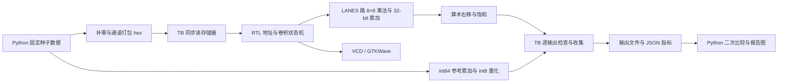
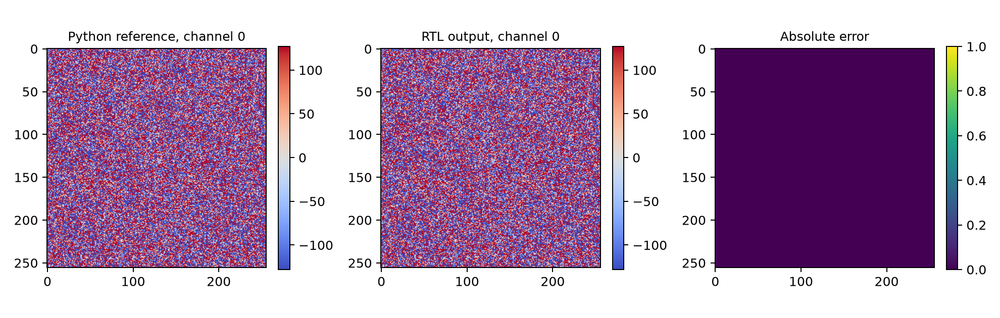
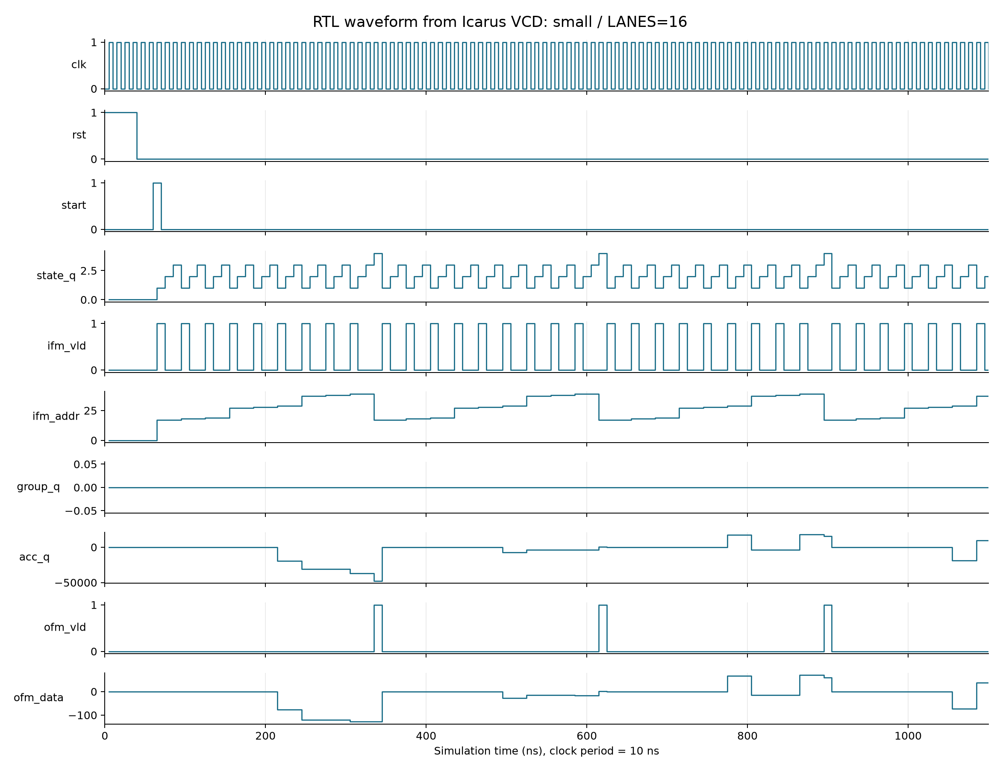
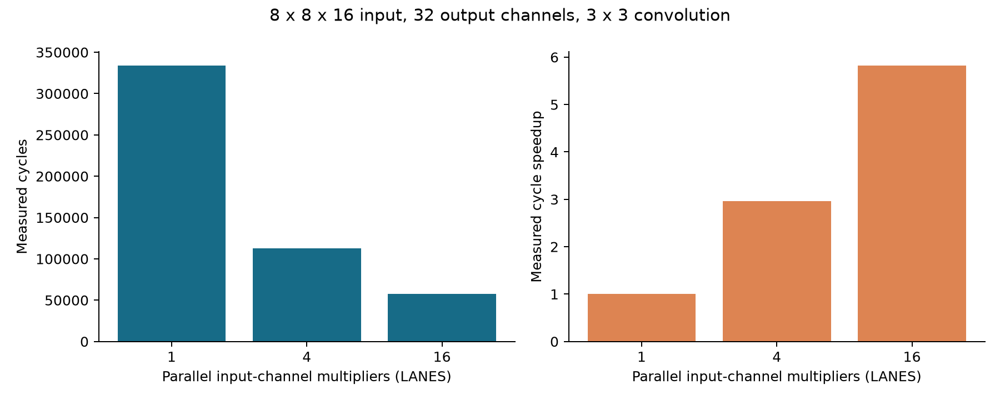

# 仿真平台下可配置 8-bit 卷积算子的设计与验证

课程：人工智能芯片导论；实验日期：2026 年 10 月 17 日。

实现语言：SystemVerilog、Python。

主实验：256×256×16 输入，32×3×3×16 卷积核，256×256×32 输出

## 摘要

本实验实现了输入通道并行度可配置的定点卷积加速器，建立了由 Python 参考计算、Icarus Verilog 自校验仿真和 GTKWave 波形查看组成的实验平台。输入、权重和输出均采用有符号 8-bit 表示，乘积采用 16-bit 表示，中间累加采用 32-bit 表示。主实验完成 301,989,888 次乘累加，全部 2,097,152 个量化输出及对应原始累加值与整数参考逐项一致。17 组快速回归进一步验证了卷积核、空间尺寸、通道数、填充、步长和量化参数的配置能力。对于相同的 8×8×16 输入及 32 个输出通道，1、4、16 路版本分别耗时 333,825、112,641、57,345 个周期，16 路版本取得 5.821 倍周期加速。Yosys 综合检查确认三种配置分别生成 1、4、16 个有符号 8×8 数据乘法器。

## 1. 实验内容

实验围绕一层整数卷积建立完整的数据生成、硬件计算、结果收集和验证流程，包含以下工作。

1. 实现可综合的卷积状态机、地址发生器、通道并行乘累加和饱和量化电路。
2. 用 Verilog testbench 模拟同步读存储器，装载输入与权重，保存输出，并自动比较 8-bit 结果和 32-bit 累加结果。
3. 用 Python 组织 conda 工具环境、参考数据、参数化编译、仿真执行、周期统计和图像生成。
4. 在主实验尺寸上完成全量验证，在参数变化场景上检查可配置性，并在相同配置下比较串行与并行版本。
5. 导出实际 VCD 波形，使用 GTKWave 加载查看，结合状态机解释关键电平变化。

课程 baseline 提供了预填充输入、按空间位置打包通道的存储布局，以及“累加后右移 8 位并饱和”的定点语义。本实验据此独立实现 `conv_sim/` 下的 RTL、testbench 和实验驱动，并将卷积核高宽、步长及通道并行度扩展为参数。全部实验的输出通道数均由显式配置给出，主实验取 32。

## 2. 环境配置与复现

### 2.1 实测环境

| 项目 | 版本或配置 |
|---|---|
| 操作系统 | macOS 26.7.1，Apple Silicon / arm64 |
| 环境管理 | conda，项目内前缀 `.conda-env/` |
| Python | 3.11.17 |
| NumPy | 2.4.6 |
| Matplotlib | 3.11.2 |
| Icarus Verilog | 12.0 stable，SystemVerilog 2012 模式 |
| GTKWave | 3.3.116，GTK3 / Quartz |
| Yosys | yowasp-yosys 0.70.0.0.post1259 |
| Ruff | 0.17.1 |
| 仿真时钟 | 周期 10 ns |
| 随机种子 | 20261017 |

Python 与工具构建依赖统一维护在 [`environment.yml`](../environment.yml)。Icarus 与 GTKWave 从固定发布标签构建并安装到 conda 前缀；macOS 的 GTKWave 使用独立 Quartz 窗口，安装脚本处理 X11 嵌入窗口的兼容配置。构建源码的 SHA-256 见 [`toolchain_sources.json`](evidence/toolchain_sources.json)。[`conda-osx-arm64.lock.txt`](../conda-osx-arm64.lock.txt) 保存本机精确 conda 包清单，`requirements-lock.txt` 保存 pip 补充工具版本。

### 2.2 一键复现顺序

在仓库根目录执行：

```bash
conda env create -f environment.yml
conda activate aichip
python conv_sim/scripts/install_tools.py
python conv_sim/python/experiment.py --suite all
python conv_sim/scripts/validate.py
python conv_sim/python/figures.py
gtkwave report/evidence/wave.vcd conv_sim/wave.gtkw
```

`--suite quick` 运行 17 组快速回归，`--suite full` 运行完整尺寸的 16 路实现。`--suite all` 顺序执行两者。相同随机种子在不同并行度之间复用同一套输入和权重，保证速度对比的工作量一致。运行结果保存在 `results/`，提交的实测摘要、日志、数据摘要和波形位于 `report/evidence/`。

## 3. 实验方法与实现

### 3.1 数学定义与定点语义

设输入为 $X\in\mathbb{Z}^{H\times W\times C_{in}}$，权重为 $K\in\mathbb{Z}^{C_{out}\times K_h\times K_w\times C_{in}}$，填充宽度为 $P$，步长为 $S$。输出尺寸为

$$
H_o=\left\lfloor\frac{H+2P-K_h}{S}\right\rfloor+1,\qquad
W_o=\left\lfloor\frac{W+2P-K_w}{S}\right\rfloor+1.
$$

按照深度学习常用的互相关定义，单个输出的原始累加为

$$
A_{y,x,n}=\sum_{i=0}^{K_h-1}\sum_{j=0}^{K_w-1}\sum_{c=0}^{C_{in}-1}
X_{pad}[yS+i,xS+j,c]K[n,i,j,c].
$$

量化过程为

$$
Y_{y,x,n}=\operatorname{clip}(A_{y,x,n}\mathbin{\ggg}Q,-128,127),
$$

其中 $Q=\texttt{SHIFT}$，主实验取 8，$\ggg$ 表示保持符号的算术右移。本层使用零偏置、恒等激活。负数右移向负无穷取整，例如 $-3\ggg1=-2$。int8 乘积的绝对值至多为 16,384，主实验单个输出包含 144 个乘积，最坏绝对累加上界为 2,359,296，处于有符号 int32 范围内。

### 3.2 平台结构与数据流



输入按 `[h,w,c]` 布局，权重按 `[n,kh,kw,c]` 布局。每个存储字包含某个空间位置的全部输入通道，通道 0 对应最低 8 位。主实验输入和权重读总线宽度均为 128 bit。输出空间地址对应一个 32 通道打包字，RTL 每次给出一个 8-bit 通道结果及 32-bit 独热写使能。

Python 对输入四周补零，主实验存储空间为 258×258 个输入字。通道打包代码如下，最右边的十六进制字段对应通道 0：

```python
mask = (1 << bits) - 1
for row in values:
    stream.write(
        "".join(f"{int(v) & mask:0{bits // 4}x}" for v in row[::-1])
        + "\n"
    )
```

输入、权重、8-bit 参考和 32-bit 参考分别保存为 `ifm.hex`、`kernel.hex`、`golden.hex`、`golden_acc.hex`。四种文件的 SHA-256 和参数均写入 `metadata.json`，便于确认实验数据一致。

### 3.3 Python 整数参考实现

[`experiment.py`](../conv_sim/python/experiment.py) 在每个核位置抽取步长对应的输入切片，用 int64 整数收缩计算通道内积：

```python
acc += np.einsum(
    "hwc,nc->hwn",
    window.astype(np.int64),
    kernel[: c["COUT"], kh, kw].astype(np.int64),
    optimize=False,
)
assert np.max(np.abs(acc)) < 2**31
quantized = np.clip(acc >> c["SHIFT"], -128, 127).astype(np.int8)
```

int64 参考运算保留完整数学和，随后检查其位宽范围并导出 int32。快速回归中的每种输入形状额外使用独立标量循环交叉核对，标量实现逐项计算原图坐标，检查边界并累加。这样可同时检查预填充、切片步长、核布局与通道收缩。

### 3.4 可综合 RTL 状态机

[`conv.sv`](../conv_sim/rtl/conv.sv) 使用六态有限状态机。

| 状态 | 编码 | 主要动作 |
|---|---:|---|
| `IDLE` | 0 | 接收启动，锁存三个基址，清零坐标和累加器 |
| `REQUEST` | 1 | 同时发出输入与权重读请求 |
| `WAIT_DATA` | 2 | 锁存同步存储器返回的数据 |
| `CALCULATE` | 3 | 按组执行通道乘累加，推进核坐标 |
| `WRITE_OUT` | 4 | 输出单个通道结果，推进输出坐标 |
| `DONE` | 5 | 产生完成电平，下一拍回到空闲 |

输入通道被划分为 $G=\lceil C_{in}/L\rceil$ 组，$L=\texttt{LANES}$。每个核位置先完成两拍读请求与锁存，再执行 $G$ 拍分组累加。输出坐标依次遍历输出行、输出列、输出通道；一个输出通道的完整累加完成后写回并清零累加器。

地址由输出坐标、核坐标及锁存基址组合生成：

```systemverilog
ifm_addr_o = ifm_base_q
    + (oh_q*STRIDE + kh_q)*PADDED_W + ow_q*STRIDE + kw_q;
knl_addr_o = knl_base_q
    + (oc_q*KERNEL_H + kh_q)*KERNEL_W + kw_q;
ofm_addr_o = ofm_base_q + oh_q*OW + ow_q;
```

三个地址接口均为 20 位。TB 分别采用 17、29、43 三个非零基址，使地址验证覆盖基址偏移。启动时锁存地址，计算过程稳定使用该次任务的配置。`H/W/CIN/COUT/KERNEL_H/KERNEL_W/PAD/STRIDE/SHIFT/LANES` 在编译时参数化，基址与启动在运行时配置。

同步读时序由以下 RTL 实现：

```systemverilog
REQUEST: state_q <= WAIT_DATA;
WAIT_DATA: begin
    ifm_q <= ifm_data_i;
    knl_q <= knl_data_i;
    state_q <= CALCULATE;
end
CALCULATE: begin
    acc_q <= acc_q + group_sum;
    // 根据通道组、核坐标和输出坐标推进状态。
end
```

外部存储器在 `REQUEST` 的采样沿更新数据，RTL 在下一沿锁存。该协议与 TB 的非阻塞存储器赋值保持一致。复位采用异步高有效，完成态持续一拍，并支持任务结束后再次启动。

### 3.5 通道并行乘累加

通过 `generate` 实例化恰好 `LANES` 个乘法器。输入动态切片选择当前通道组，尾组超出 `CIN` 的通道置零，因此 `CIN` 可以取 5、7 等非整除值，也支持并行数大于通道数。

```systemverilog
wire signed [7:0] x = (group_q*LANES + lane < CIN)
    ? $signed(ifm_q[(group_q*LANES + lane)*8 +: 8]) : 8'sd0;
wire signed [7:0] w = (group_q*LANES + lane < CIN)
    ? $signed(knl_q[(group_q*LANES + lane)*8 +: 8]) : 8'sd0;
assign product[lane] = x*w;
```

乘积保存为有符号 16 位，并在组内求和之前显式符号扩展到 32 位：

```systemverilog
always_comb begin
    group_sum = 32'sd0;
    for (integer n = 0; n < LANES; n = n + 1)
        group_sum = group_sum + {{16{product[n][15]}}, product[n]};
end
```

`acc_q` 在时钟沿累加组内和。`LANES=1` 每拍处理一个输入通道，`LANES=16` 在主实验中每拍处理一个核位置的全部 16 个输入通道。串并行版本共享完全相同的状态机、量化和存储协议。

### 3.6 量化与输出接口

量化采用有符号算术右移，然后比较上下界并输出饱和值：

```systemverilog
shifted = acc_q >>> SHIFT;
if (shifted > 32'sd127) ofm_data_o = 8'h7f;
else if (shifted < -32'sd128) ofm_data_o = 8'h80;
else ofm_data_o = shifted[7:0];
```

`WRITE_OUT` 状态下，`ofm_vld_o=1`，`ofm_strb_o[oc_q]=1`。TB 在上升沿将 `ofm_data_o` 写入打包输出字的对应通道，`ofm_acc_o` 同时给出量化前的累加值。逐项比较原始累加，可区分饱和输出相同而内部和不同的情况。

### 3.7 Testbench 数据加载与自校验

[`tb_conv.sv`](../conv_sim/tb/tb_conv.sv) 通过 plusargs 接收文件路径，再用 `$readmemh` 装载数据。同步输入存储器采用如下模式，权重存储器采用相同协议：

```systemverilog
$readmemh(ifm_path, ifm_mem);
$readmemh(kernel_path, knl_mem);
$readmemh(golden_path, golden);
$readmemh(golden_acc_path, golden_acc);

// 时钟上升沿处理有效的输入读请求。
if (ifm_vld)
    ifm_data <= ifm_mem[ifm_addr-IFM_BASE];
```

每个有效输出均进行两次位精确比较：

```systemverilog
if (ofm_data !== golden[position][channel*8 +: 8])
    errors = errors+1;
if (ofm_acc !== golden_acc[position][channel*32 +: 32])
    errors = errors+1;
```

平台还检查地址上下界、X/Z、独热使能、遍历次序、重复或丢失写回、完成时机和超时。完成后保存通道打包的 `output.hex` 与 `tb_metrics.json`；出现错误时执行 `$fatal`，使 Python 驱动获得非零退出码。Python 再次解包输出文件，逐元素比较 int8 参考，计算最大绝对误差和不匹配数量。

快速回归中每个配置运行两次，并在两次之间复位。独立验证脚本追加不复位的连续两次启动测试，并通过翻转一个参考输出位验证自校验链路对错误的检测能力。

### 3.8 周期模型与性能口径

设输出标量数为 $N=H_oW_oC_{out}$，核空间位置数为 $K_hK_w$，通道组数为 $G$。从采样启动沿到采样完成沿的周期差为

$$
T_{cycles}=N\left[K_hK_w(G+2)+1\right]+1.
$$

式中每个核位置的额外两拍用于请求和锁存，每个输出额外一拍用于写回，最后一拍用于完成采样。TB 对每次任务的实测周期都检查该公式。

周期加速比定义为 $T_{L=1}/T_L$。给定 10 ns 的测试时钟，模拟时间为 $T_{cycles}\times10$ ns。主机墙钟时间是 `vvp` 程序实际运行耗时，包含事件调度、检查和文件输出开销。硬件频率与映射资源的后续评估可通过具体 FPGA/ASIC 工艺的布局布线完成。

## 4. 实验结果与分析

### 4.1 完整尺寸全量验证

主实验采用 `H=W=256`、`CIN=16`、`COUT=32`、`KERNEL_H=KERNEL_W=3`、`PAD=1`、`STRIDE=1`、`SHIFT=8`、`LANES=16`。实际运行记录见 [`full_lanes16.log`](evidence/full_lanes16.log)，数据参数和摘要见 [`full_data.json`](evidence/full_data.json)。

| 指标 | 实测结果 |
|---|---:|
| 输出尺寸 | 256×256×32 |
| 输出标量数 | 2,097,152 |
| 乘累加次数 | 301,989,888 |
| int8 不匹配数量 | 0 |
| int8 最大绝对误差 | 0 |
| TB int8/int32 合计错误数 | 0 |
| 周期数 | 58,720,257 |
| 10 ns 时钟下模拟时间 | 587.20257 ms |
| `vvp` 主机墙钟耗时 | 538.764 s |
| 原始累加最小值 / 最大值 | −319,463 / 362,823 |
| 负饱和 / 正饱和数量 | 645,368 / 646,034 |

仿真输出为：

```text
run=1 cycles=58720257 outputs=2097152 errors=0
PASS
```

本配置每个输出需要 $9(1+2)+1=28$ 拍，故理论值为 $2,097,152\times28+1=58,720,257$，与实测一致。输入与权重覆盖完整 int8 范围，产生了充足的正负饱和样本；32-bit 原始累加逐项核对同时验证了饱和前的计算正确性。



**图 1.** 完整尺寸的输出通道 0 对照图。参考值和 RTL 输出逐像素一致，绝对误差平面为零。全部 32 个通道均已完成同样的自动比较。

### 4.2 参数变化与覆盖范围

快速回归共运行 17 个“配置—并行度”组合，每组完成两次任务。各配置及输出尺寸如下。

| 场景 | 输入 H×W×CIN | COUT | 核高×宽 | PAD | 步长 | SHIFT | 输出高×宽 | LANES |
|---|---|---:|---|---:|---:|---:|---|---|
| small | 8×8×16 | 32 | 3×3 | 1 | 1 | 8 | 8×8 | 1、4、16 |
| rectangular | 7×11×5 | 7 | 3×3 | 1 | 1 | 8 | 7×11 | 1、4、8 |
| pointwise | 5×9×3 | 5 | 1×1 | 0 | 1 | 8 | 5×9 | 1、4 |
| stride2 | 9×12×7 | 9 | 3×3 | 1 | 2 | 8 | 5×6 | 1、4 |
| kernel5 | 6×8×3 | 4 | 5×5 | 2 | 1 | 8 | 6×8 | 1、4 |
| valid | 7×10×5 | 3 | 2×3 | 0 | 1 | 4 | 6×8 | 1、4 |
| quantization | 1×8×1 | 1 | 1×1 | 0 | 1 | 1 | 1×8 | 1、4 |
| negative_saturation | 1×8×1 | 1 | 1×1 | 0 | 1 | 1 | 1×8 | 1 |

全部组合均为 `errors=0`，最大绝对误差为 0；完整周期和墙钟记录见 [`results_table.md`](evidence/results_table.md)。矩形场景验证了独立行列尺寸和非整除通道，`stride2` 验证了步长寻址与输出取整，`valid` 验证了非方形核与零填充，`kernel5` 验证了更大核和两圈补零。不同并行度在同一场景产生完全相同的输出。

量化定向测试取权重 3、`SHIFT=1`，数据与结果如下：

| 输入 | 原始累加 | 算术右移后 | int8 输出 |
|---:|---:|---:|---:|
| −128 | −384 | −192 | −128 |
| −127 | −381 | −191 | −128 |
| −3 | −9 | −5 | −5 |
| −1 | −3 | −2 | −2 |
| 0 | 0 | 0 | 0 |
| 1 | 3 | 1 | 1 |
| 126 | 378 | 189 | 127 |
| 127 | 381 | 190 | 127 |

负权重场景进一步将权重设为 −3，覆盖符号相乘和反向饱和。两个场景共同覆盖 int8 端点、负奇数右移、零值及正负截断边界。

本实现已实测 H/W 1～256、CIN 1～16、COUT 1～32 中上述离散组合。合法参数须满足正输出尺寸、`1≤COUT≤KERNELS`、20 位地址范围和 int32 累加界限。核高宽独立配置，`SHIFT` 支持 0～31，并行度支持正整数。完整配置约束见 [`RTL 接口说明`](../conv_sim/rtl/README.md)。

### 4.3 实际电平波形与分析

TB 使用 `$dumpfile` 和 `$dumpvars` 输出真实 VCD，记录时钟、复位、启动、完成、状态、地址、累加器和写回信号。GTKWave 实际加载 [`wave.vcd`](evidence/wave.vcd) 与 [`wave.gtkw`](../conv_sim/wave.gtkw)，加载记录见 [`gtkwave_load.log`](evidence/gtkwave_load.log)。以下电平图由同一 VCD 的事件时间戳生成。



**图 2.** `small` 配置、`LANES=16` 的 0～1100 ns 时序。多位信号以其数值绘制，累加与输出使用有符号解释，图中状态编码对应第 3.4 节状态表。

波形显示，复位在 40 ns 释放，`start` 在 60～70 ns 有效，RTL 在 65 ns 上升沿接收任务并进入请求态。75 ns 上升沿存储器响应，85 ns 上升沿锁存数据，95 ns 上升沿完成第一组累加。随后每个核位置重复三拍“请求—锁存—计算”。左上角输出对应的前几个核位置落在补零区，累加器保持零，进入有效输入区后出现带符号的累加变化。

第一个输出的 `ofm_vld` 在 335～345 ns 为高，TB 在 345 ns 上升沿采样通道 0。此时原始累加为 −47,835，经右移与饱和得到 −128。第二、三个通道分别在 625 ns、905 ns 被采样，原始累加为 345 和 15,599，量化结果为 1 和 60。相邻输出间隔均为 280 ns，即 28 个时钟周期，与周期模型一致。`LANES=16` 覆盖所有输入通道，组计数器保持为零。

TB 默认转储前 600 个计算周期，并在最后一次写回附近恢复记录；计算过程和自校验持续覆盖全部输出。VCD 因此包含明确的暂停转储区间，便于用较小文件观察启动、稳定计算和结束。完成状态在最终写回之后被采样，TB 自动检查完成时机与输出总数。

### 4.4 同配置串并行加速

性能比较固定输入为 8×8×16、输出为 8×8×32、核为 3×3，并使用相同数据和定点参数。仅修改 `LANES`。

| LANES | 每核位置计算组数 | 每输出周期 | 实测总周期 | 10 ns 下模拟时间/ms | 周期加速比 | 两次任务主机耗时/s |
|---:|---:|---:|---:|---:|---:|---:|
| 1 | 16 | 163 | 333,825 | 3.33825 | 1.000 | 4.484 |
| 4 | 4 | 55 | 112,641 | 1.12641 | 2.964 | 3.486 |
| 16 | 1 | 28 | 57,345 | 0.57345 | 5.821 | 1.051 |



**图 3.** 相同工作量下，增加通道乘法器显著降低计算周期。柱状图数据来自 TB 的实测周期。

并行加速来源于通道归约轮数的减少。1 路时每个核位置需要 16 拍计算，16 路时减少为 1 拍；各核位置仍包含两拍请求与锁存，每个输出还需一拍写回，因此总体加速由周期公式给出的 163/28≈5.821 决定。该结果表明计算并行度提高后，访存控制开销在总周期中的占比上升。

`rectangular` 场景中 CIN=5，LANES=8 时一轮覆盖全部通道；多余的三路输入屏蔽为零，其周期加速为 2.286。`quantization` 场景 CIN=1，LANES 从 1 增加到 4 后仍为一组，周期数均为 33。这两组结果进一步说明加速取决于通道组数的实际变化。

主实验完整尺寸完成了 16 路实测，同配置的串并行对照采用上述 `small` 场景。两者使用同一 RTL 与周期定义，空间尺寸通过参数传入。

### 4.5 综合结构与验证平台有效性

使用 `validate.py` 执行 Yosys `read_verilog -sv`、参数设置、`proc`、`opt`、`check` 和 `stat`，得到以下通用 RTL 单元统计：

| LANES | 有符号 8×8 数据乘法器 | 全部 `$mul` | `$add` | 触发器位数 | 通用单元总数 | check 问题数 |
|---:|---:|---:|---:|---:|---:|---:|
| 1 | 1 | 4 | 16 | 543 | 103 | 0 |
| 4 | 4 | 7 | 22 | 543 | 127 | 0 |
| 16 | 16 | 19 | 46 | 543 | 223 | 0 |

全部 `$mul` 中包含三个地址计算乘法单元，数据乘法器根据输入位宽及有符号属性单独识别。上述结构统计确认 `LANES` 改变了实际并行运算资源，状态寄存器规模保持一致。具体网表摘要与工具日志见 [`synthesis_summary.json`](evidence/synthesis_summary.json)。该统计对应通用 RTL 综合层级；具体 LUT、DSP、面积与时序指标可在后续目标器件映射中获得。

无复位重复启动使用 H=3、W=4、CIN=5、COUT=2、KERNELS=3、步长 2，分别在 1、4、16 路运行两次，周期为 513、297、225，全部错误数为零。这一实验同时覆盖实际输出通道少于核文件通道的配置。结果见 [`restart.json`](evidence/restart.json)。

故障注入翻转首个 int8 参考位，TB 在两次任务中均捕获不匹配并以退出码 1 结束，验证脚本判定 `detected=true`。记录见 [`fault_injection.json`](evidence/fault_injection.json) 与对应日志。该实验确认了参考文件、输出比较、错误汇总及失败退出的完整检测链路。

## 5. 实验总结与心得

本实验完成了从定点数学定义到可综合 RTL、再到全量自校验仿真的实现过程。主实验的全部 2,097,152 个输出及原始累加与整数参考一致，参数回归覆盖了空间维度、通道尾组、不同核形状、步长和量化边界；周期模型与每次任务的实测值一致。

实现过程中，数据布局和时序协议是连接 Python 与 RTL 的关键。通道 0 位于最低位的统一约定，使文件打包、动态切片和输出收集保持一致；请求与锁存分离，使同步读内存的非阻塞更新具有清楚的采样关系。对原始累加和量化输出分别核对，可以直接定位符号扩展、算术右移与饱和相关的问题。

并行实验体现了运算资源与控制开销的共同影响。16 路数据乘法将同配置周期缩短至串行版本的约 17.18%，综合单元数由 103 增至 223。进一步优化可围绕三个方向开展：以平衡加法树和流水寄存器缩短组内归约路径；以双缓冲重叠读取和计算；以行缓存与权重复用降低重复访存。可配置参数、整数参考和自校验平台为后续优化提供了统一的正确性与性能基准。

## 参考资料与材料索引

1. 课程材料：《人工智能芯片导论大作业要求》及本地 baseline 的卷积语义、接口与参考生成脚本。
2. Icarus Verilog 官方源码与文档：<https://github.com/steveicarus/iverilog>，实验版本 v12_0。
3. GTKWave 官方源码与文档：<https://github.com/gtkwave/gtkwave>，实验版本 v3.3.116。
4. NumPy `einsum` 文档：<https://numpy.org/doc/stable/reference/generated/numpy.einsum.html>。
5. Yosys 文档：<https://yosyshq.readthedocs.io/projects/yosys/en/latest/>。
6. 本次实测结果：[`summary.json`](evidence/summary.json)、[`results_table.md`](evidence/results_table.md)、[`environment.json`](evidence/environment.json)；上述结果均由实际程序执行生成。
